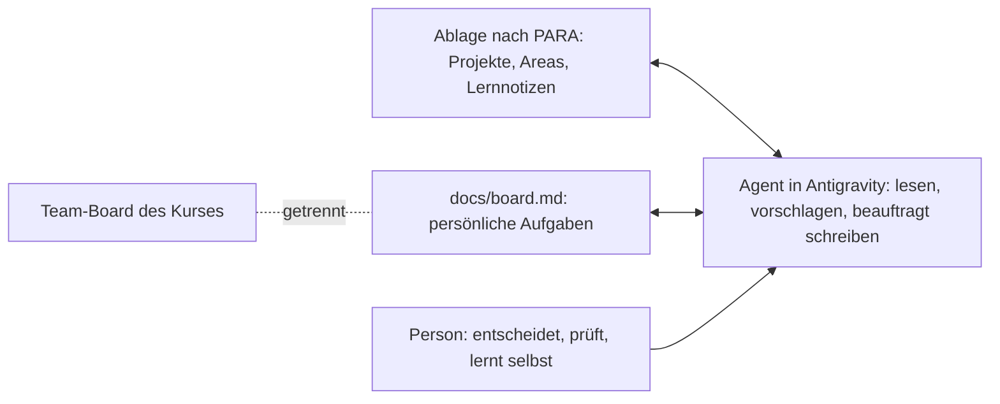

# second-brain-studium

Eine persönliche Ablage für das Studium, in der ein KI-Agent mitarbeitet. Beispielperson ist die fiktive Studentin Nele Hartwig im 2. Semester Online-Medien-Management. Der Ordner wird in Google Antigravity geöffnet; dort liest der Agent mit einem Gemini-Modell die Dateien, bereitet Tagesnotizen und Wochenpläne vor und pflegt ausdrücklich beauftragte Dateien.

**Alle Personen, Termine und Inhalte sind fiktiv.** Neles Beispieldaten folgen der Terminfolge des Kurses (Termin 1, Werkzeugtermin, Termin 2), aber einem eigenen Kalender. Es gibt keine verbundenen Dienste und keine Kontaktdaten. Der Ordner besteht nur aus Markdown-Dateien und braucht außer Antigravity keine Installation.

## Wie die Teile zusammenspielen

`AGENTS.md` enthält die Regeln für den Agenten. Antigravity lädt diese Datei in jeder Unterhaltung im Projektordner. Das Team-Board des Projektteams liegt außerhalb und wird hier nicht gespiegelt.

## Ablage nach PARA

| Ordner | Inhalt |
|---|---|
| `00_Inbox/` | Schnellnotizen, Mitschriften und Exportdateien wie die Zeiterfassung, noch nicht einsortiert |
| `01_Projects/` | Vorhaben mit Ende: Projektteam, Fokus-Experiment, Semesterarbeit, Klausur |
| `02_Areas/` | Dauerhafte Verantwortung: Studium, Nebenjob, Gesundheit |
| `03_Resources/` | Lernnotizen, Vorlagen, Agent-Kontext |
| `04_Archive/` | Abgeschlossene Projekte, etwa aus dem 1. Semester |
| `05_Daily/` | Tagesnotizen und Wochenpläne |
| `docs/` | Board, Delegationsprotokoll, Erste Schritte, Demo-Drehbuch, Kursaufträge |

Der typische Weg: **Inbox → Projekt oder Area → Archiv**.

## Sechs Prinzipien

1. **Eine Quelle für Aufgaben:** Persönliche Aufgaben, Status und Fälligkeiten stehen nur in `docs/board.md`.
2. **Projektdateien mit Log:** Stammdaten, Hintergrund und datierte Einträge, keine Aufgabenlisten.
3. **Kontext gezielt laden:** Der [Kontextplan](03_Resources/Agent_Kontext/kontext.md) nennt je Auftrag die nötigen Dateien.
4. **Drei Stufen:** Lesen, lokal schreiben und extern handeln sind getrennte Erlaubnisse. Ein Entwurf ist kein Versand.
5. **Belege erhalten:** Quellen und Zeitpunkte nennen, Lücken offen lassen, nichts erfinden.
6. **Ergebnis prüfen:** Jede Änderung im Review ansehen. Delegieren, behalten, prüfen gilt wie im Kurs.

## Rundgang in sechs Minuten

| Minute | Datei | Was sich zeigt |
|---|---|---|
| 1 | [AGENTS.md](AGENTS.md) | Regeln, die in jeder Unterhaltung gelten |
| 2 | [Kontextplan](03_Resources/Agent_Kontext/kontext.md) | Je Auftrag nur die nötigen Dateien |
| 3 | [DWSC-Projekt](01_Projects/02_DWSC_Morgenrot/info_02.md) und [Board](docs/board.md) | Kontext und Aufgaben getrennt |
| 4 | [Lernnotiz](03_Resources/Lernnotizen/dwsc-modul-1.md) | Selbst geschrieben, vom Agenten abgefragt |
| 5 | [Demo-Drehbuch](docs/demo-drehbuch.md) | Sieben Aufträge mit Schreibgrenzen |
| 6 | [Delegationsprotokoll](docs/delegationsprotokoll.md) und [Kursaufträge](docs/kurs-auftraege.md) | Was an den Agenten geht und wie es geprüft wird, ein Auftrag je Termin |

## Einstieg

Einrichtung ohne Git: [Erste Schritte](docs/erste-schritte.md). Danach das [Demo-Drehbuch](docs/demo-drehbuch.md) durchgehen und die Beispielinhalte durch eigene ersetzen. Ab dem Werkzeugtermin begleiten das [Delegationsprotokoll](docs/delegationsprotokoll.md) und die [Kursaufträge](docs/kurs-auftraege.md) den Kurs bis Termin 9.

Lizenz: [MIT](LICENSE).
